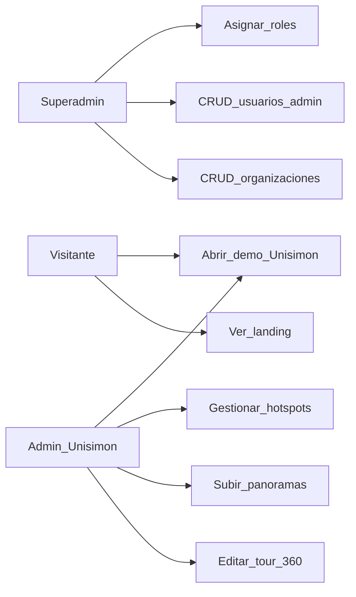

# Actores y casos de uso (UML / Mermaid)

## Actores

| Actor | Descripción |
|-------|-------------|
| Visitante | Ve landing y demos/tours publicados |
| Superadmin | Gestiona organizaciones y usuarios admin |
| Admin organización | Administra tours de su cliente (ej. Unisimón) |
| Editor de tour | Edita escenas/hotspots (puede ser el mismo admin) |

## Usuarios semilla

| Email | Rol | Propósito |
|-------|-----|-----------|
| `superadmin@orbe360.local` | Superadmin plataforma | Gestionar clientes y admins |
| `admin@unisimon.local` | Org admin Unisimón | Admin del tour 360 campus |

## Diagrama de casos de uso

## Flujos prioritarios
1. Visitante → Landing → Demo Unisimón.
2. Superadmin → Login → Crear org → Crear admin → Asignar.
3. Admin Unisimón → Login → Control Web → Subir/editar → Publicar.
