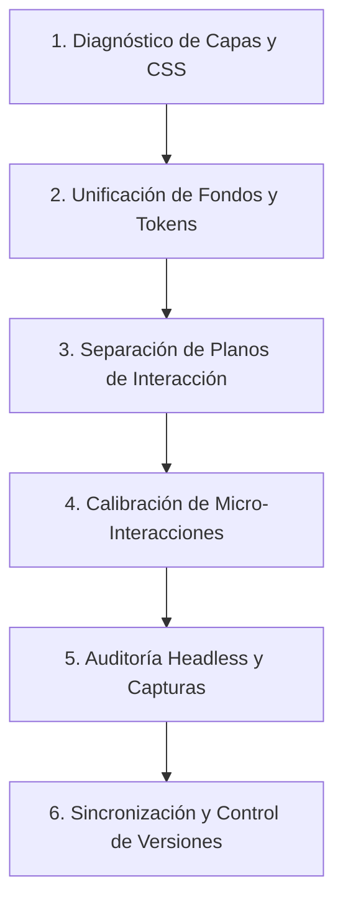

# 64 — Criterios de Rediseño, Arquitectura Motion y Protocolo Visual de Landing Page

**Fecha de Creación / Ejecución:** 15 de Octubre de 2026
**Proyecto:** ORBE360 (Desarrollo y Plataforma SaaS)
**Autoría / Metodología:** Antigravity AI + Equipo de Desarrollo Orbe360
**Ubicación de Referencia:** `docs/producto/64-criterios-redisenio-motion-landing-guia-maestra.md`

---

## 1. Propósito del Documento

Este documento consolida el diagnóstico técnico, los principios estéticos, la arquitectura de código y el flujo de trabajo estandarizado que se utilizó para transformar la **Landing Page** de ORBE360 (`/plataforma/index.html`).

Sirve como **Guía Maestra y Manual de Procedimiento** para que cualquier futuro rediseño, módulo o pantalla del ecosistema (Admin, Visor 360, Control Web, Portal de Clientes) se ejecute bajo el mismo nivel de excelencia, sin improvisaciones y con total trazabilidad técnica.

---

## 2. Diagnóstico del Estado Inicial (Problemas Detectados)

Antes de la intervención, la interfaz presentaba incoherencias visuales y conflictos de capas CSS/DOM:

| Elemento / Sección                                | Estado Inicial (Problemático)                                                                                                                | Causa Técnica                                                                                                                                             |
| :------------------------------------------------- | :-------------------------------------------------------------------------------------------------------------------------------------------- | :--------------------------------------------------------------------------------------------------------------------------------------------------------- |
| **Header Superior**                          | Se observaba como una barra blanca sólida y "partida" que cortaba el Hero con una línea divisoria gris al cargar la página.                | `.public-nav` tenía fondo opaco (`rgba(255, 255, 255, 0.82)`) y borde rígido incluso en `scrollY === 0`.                                           |
| **Secciones Partidas (Cortes Horizontales)** | Al hacer scroll, la página se dividía en franjas duras alternadas (blanco $\to$ gris/azul arcilla $\to$ blanco $\to$ pie de página). | Cada `<section>` (`.hero`, `.section--logos`, `.section`, `.cta-band`) tenía `background: var(--orbe-...)` sólido que tapaba el fondo.       |
| **Sección CTA Duplicada**                   | Existían dos bloques seguidos de llamada a la acción con títulos similares ("Lleva la comunicación..." y "Lleva tus espacios...").        | Código duplicado en el HTML que generaba dos cajas consecutivas y dos bordes horizontales.                                                                |
| **Orbe del Cursor Bloqueado**                | El orbe seguidor solo se veía por encima del header en el borde superior; al entrar al contenido desaparecía o no funcionaba.               | El lienzo estaba dentro de `.story-bg` (`z-index: 0`). Las tarjetas y secciones con `z-index: 1` o fondos opacos lo cubrían por completo.           |
| **Orbes de Fondo Apagados y Cortos**         | Las burbujas se veían excesivamente opacas en modo claro y dejaban de aparecer al llegar a la mitad inferior de la página.                  | Opacidad fijada en `0.16` en modo claro, y el límite vertical (`maxY`) estaba restringido a 5.500 px fijos sin calcular la altura real del documento. |
| **Tipografía en Fallback Serif**            | Al cargar estilos, las fuentes se mostraban en Times New Roman antes de normalizar.                                                           | La regla `@import url("/plataforma/tokens.css");` no estaba en la primera línea absoluta del archivo CSS, invalidando la cascada.                       |

---

## 3. Criterios de Diseño y Arquitectura Aplicados

### A. Continuidad Espacial Total (Zero-Seam Canvas)

- **Eliminación de Franjas Rígidas:** Se eliminaron los fondos opacos de todos los contenedores `<section>`. El fondo general de la página (`body.marketing`) actúa como un **lienzo único y continuo** donde la malla espacial y los orbes flotan libremente.
- **Glassmorphism Funcional (Efecto Cristal Esmerilado):** Solo las tarjetas de contenido (`.feature-card`, `.sede-card`, `.a11y-box`) conservan fondo con `backdrop-filter: blur(14px)` y bordes translúcidos de 1px. Esto garantiza legibilidad sin fragmentar el scroll.

### B. Arquitectura de Doble Lienzo (Dual-Canvas Architecture)

Para evitar que los elementos de la interfaz tapen las interacciones dinámicas:

1. **Lienzo de Fondo (`ambient3dCanvas` en `z-index: 0`):**
   - Renderiza las 8 burbujas volumétricas 3D con físicas salvapantallas.
   - Renderiza la geometría wireframe espacial (Mobbin 3D Spatial Ring).
2. **Lienzo de Primer Plano (`cursorOrbCanvas` en `z-index: 999; pointer-events: none`):**
   - Corre en capa fija superior sobre todo el viewport.
   - Dibuja el orbe seguidor del puntero con halo difuso, núcleo brillante y estela suave (*motion trail*).
   - **Resultado:** El usuario ve el orbe iluminar con suavidad los botones, tarjetas e imágenes que sobrevuela, sin importar la jerarquía de apilamiento DOM.

### C. Físicas Armónicas Salvapantallas (Squish & Stretch)

- **Rebote Elástico:** Cuando un orbe choca con los límites laterales de la ventana o sus fronteras verticales, no rebota como un punto rígido; se deforma elásticamente (`squishX = 0.74; squishY = 1.26;`) y recupera su geometría esférica gradualmente (`0.08` por frame).
- **Repulsión Magnética Suave:** Al acercar el cursor a un orbe flotante a menos de `orb.radius + 60px`, se genera una fuerza vectorial suave que lo desplaza sin colisiones bruscas.
- **Gradientes Esféricos de 4 Paradas:**
  ```javascript
  const alpha = isDark ? 0.44 : 0.28;
  gradient.addColorStop(0, `hsla(${orb.hue}, ${orb.sat}%, ${orb.light}%, ${alpha * 1.6})`);
  gradient.addColorStop(0.5, `hsla(${orb.hue + 14}, ${orb.sat}%, ${orb.light}%, ${alpha * 0.85})`);
  gradient.addColorStop(0.85, `hsla(${orb.hue + 24}, ${orb.sat}%, ${orb.light}%, ${alpha * 0.3})`);
  gradient.addColorStop(1, `hsla(${orb.hue + 32}, ${orb.sat}%, ${orb.light}%, 0)`);
  ```

### D. Header Dinámico Seamless (Zero-Border at Top)

- **En la Cima (`scrollY <= 24px`):** Fondo `transparent`, borde `transparent`, sin sombras ni filtros. Se integra orgánicamente con el Hero.
- **En Desplazamiento (`scrollY > 24px`):** Se activa la clase `.is-scrolled`, aplicando un cristal esmerilado suave (`rgba(255, 255, 255, 0.85)` en modo claro y `rgba(11, 18, 32, 0.85)` en modo oscuro con `blur(20px)` y sombra sutil).

### E. Carrusel en Acordeón con Amortiguación de Cursor

- Las 4 sedes de la Universidad Simón Bolívar se despliegan en acordeón responsivo.
- Se introdujo un temporizador de retardo de `85 ms` en los eventos `mouseenter`, eliminando la hipersensibilidad nerviosa al cruzar el puntero rápidamente.

---

## 4. Herramientas y Tecnologías Utilizadas

1. **Chrome DevTools MCP:**
   - Inyección y ejecución de scripts headless (`evaluate_script`) para verificar el estado de los canvas, dimensiones y temas.
   - Inspección de consola en tiempo real para asegurar **cero errores de Javascript**.
   - Capturas de pantalla precisas del viewport (`take_screenshot`) a escala 1920x1080.
2. **HTML5 Canvas 2D Context API:**
   - Creación de degradados radiales dinámicos, matrices de escala para deformación elástica y trazado de vectores espaciales 3D proyectados con campo de visión (`fov = 420`).
3. **Vanilla CSS con Custom Properties (CSS Tokens):**
   - Sin dependencias de frameworks externos pesados; control total de la cascada y compatibilidad cross-browser.
4. **Python Automation Scripts:**
   - Transformaciones idempotentes del DOM y sanitización de sintaxis en `index.html`, `marketing.css` y `marketing-motion.js`.

---

## 5. Pruebas y Criterios de Aceptación Cumplidos

- [X] **Consistencia de Modo Claro / Oscuro:** El contraste de textos cumple WCAG 2.1 AA en ambos temas, y la preferencia se almacena en `localStorage.getItem("orbe_theme")`.
- [X] **Continuidad de Scroll Completo:** Los orbes cubren desde `worldY: 340` (Hero) hasta más de `worldY: 6200` (Footer) adaptándose dinámicamente a la altura de página.
- [X] **No Interferencia con Accesibilidad:** El canvas posee `pointer-events: none` y `aria-hidden="true"`, permitiendo que lectores de pantalla y navegación por teclado funcionen sin obstáculos.
- [X] **Cero Conflictos de Tipografía:** `@import` de `tokens.css` ubicado en la línea 1 estricta, asegurando la carga de las fuentes Syne y Outfit.

---

## 6. Protocolo y Flujo de Trabajo para Futuros Rediseños

Cuando se decida aplicar este mismo estándar a otra pantalla del proyecto (ej. `control-web/admin.html` o `plataforma/login.html`), seguir estrictamente este flujo de 6 pasos:



1. **Paso 1: Auditoría de Capas (Layer Audit):** Identificar qué contenedores tienen fondos opacos duros (`background: white`, `background: #000`) o `z-index` conflictivos que corten la fluidez de la interfaz.
2. **Paso 2: Unificación de Tokens:** Reemplazar colores fijos por variables de `tokens.css` (`--orbe-accent`, `--orbe-ink`, `--orbe-clay-...`) para garantizar coherencia en modo claro y oscuro.
3. **Paso 3: Separación de Planos:** Si hay elementos decorativos interactivos (partículas, cursores, halos), colocarlos en capas dedicadas con `pointer-events: none` para no bloquear clics ni navegación por teclado.
4. **Paso 4: Micro-Animaciones con Amortiguación:** Evitar transiciones instantáneas o hipersensibles; usar curvas cúbicas suaves (`ease`, `300ms`) y retardos de seguridad (`85ms`) en hovers.
5. **Paso 5: Verificación Visual:** Probar en navegador real con alternancia de temas y captura de pantalla antes de dar por finalizado el cambio.
6. **Paso 6: Sincronización:** Actualizar el repositorio de desarrollo (`ORBE`) y empaquetar la distribución de despliegue (`ORBE-GP`).
